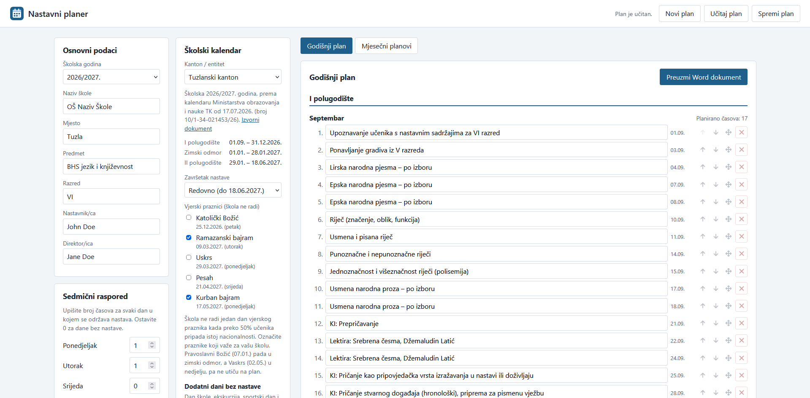
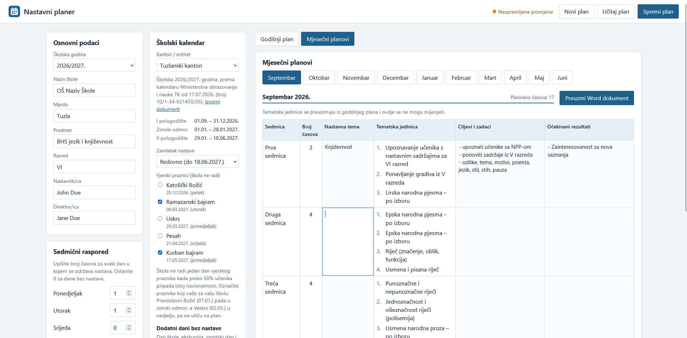

# Nastavni planer

A web app that helps teachers in the Federation of Bosnia and Herzegovina create their **yearly and monthly
teaching plans**. The teacher enters the weekly timetable, the app works out every lesson of the school year from
the official school calendar of the canton, and exports the plans as editable Word documents.

The interface and the generated documents are in Bosnian.

[](https://github.com/Amar00000/nastavni-planer/actions/workflows/deploy.yml)

**Live app: https://amar00000.github.io/nastavni-planer/**





## What it does

- Calculates the lessons of the whole school year from the weekly timetable (days of the week and hours per day),
  taking the official school calendar into account: semester dates, winter break, state and religious holidays,
  and days without classes added by the user.
- Generates the **yearly plan** table. Lesson themes are typed once there; then automatically distributed into **monthly plans**.
- Lets the teacher reorganise the themes: remove one (the ones below move up), move one step up or down, or pick a
  theme up and drop it at any place in the year. This makes it easy to reuse last year's plan.
- Exports the yearly plan and each monthly plan as **Word (.docx)** documents that can be edited further.
- Saves a plan to a file (through the normal "Save as" window in Chrome and Edge) and loads it again, warns about unsaved changes, and keeps an automatic draft in the
  browser so that closing the tab by accident does not lose the work.

## Privacy

There is no server and no account. Everything is calculated in the browser. Plans are saved to files on the
teacher's own computer, and the automatic draft stays in that browser's local storage. Nothing is sent anywhere.

## School calendars

| Canton | School year | Source |
| --- | --- | --- |
| Tuzlanski kanton | 2026/2027 | Ministry of Education and Science of Tuzla Canton, decision of 17.07.2026 |
| Kanton Sarajevo | 2026/2027 | Ministry of Education of Kanton Sarajevo, calendar published 29.07.2026 |

The links to the source documents are shown in the app next to each calendar. Calendars are plain data in
[`src/core/calendars.ts`](src/core/calendars.ts); every calendar has an id that is saved with the plan, so old
plans keep using the calendar they were made with. The other cantons are not added yet.

### Adding a calendar

1. Read the ministry's official calendar for the canton.
2. Copy the newest entry in `src/core/calendars.ts`, put the copy first, and change its id, dates and holidays.
3. Run `npm test`. Consistency tests check that dates are real, in a sensible order and in the right school year.

**Never edit or delete an old entry, saved plans refer to it.**

## Technology

React, TypeScript and Vite. [`docx`](https://github.com/dolanmiu/docx) generates the Word files,
[`date-fns`](https://date-fns.org) handles dates, [Vitest](https://vitest.dev) runs the tests. The calculation of
lessons (`src/core`) is plain TypeScript without any interface code, and is covered by unit tests.

## Running locally

```bash
npm install
npm run dev      # development server
npm test         # tests
npm run build    # production build in dist/
```

## Deployment

Pushing to `main` runs `.github/workflows/deploy.yml`, which runs the tests, builds the app and publishes it on
GitHub Pages. If a test fails, nothing is published. In the repository settings, **Pages → Source** must be set to
**GitHub Actions**. The site address is taken from the repository name, so no code change is needed if the
repository is renamed.

## Limitations

- Missing calendars. To be added before the start of the next academic year.
- Saving through the normal "Save as" window works in Chrome and Edge. Other browsers save to the Downloads folder.
